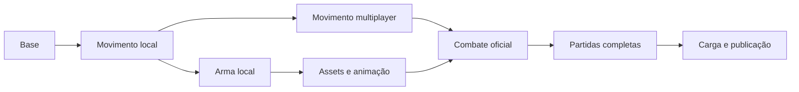

# Plano de implementação

## Escopo e estado atual

FPS casual cartunesco para 6–12 jogadores. A arquitetura original continua sendo
a referência; este documento detalha ordem, dependências, entregas e aceite.
Sem estimativas de calendário antes de calibrar a movimentação e escolher assets.

**Concluído — F00: estrutura executável.** Workspace cliente/servidor/shared,
TypeScript estrito, scripts, arena visual, mapa de colisões Rapier, conexão de sala,
spawn estático, cleanup, RTT, schema, configurações e validação básica de protocolo.
O scaffold de sala antecipa a infraestrutura da fase 2 original sem declarar
movimentação multiplayer concluída.

## Ordem e dependências

Cada etapa deve ser entregue em mudanças pequenas, com validação própria. Testes
de segurança e métricas acompanham a implementação, não ficam apenas para F07.

## F01 — Controlador local e movimentação

**Depende de:** F00. **Skills:** fps-movement, rapier-physics, threejs-fps, game-testing.

- [ ] F01.1 Capturar teclado/mouse separado do render; comandos em ticks fixos, normalização diagonal e bordas de botões.
- [ ] F01.2 Criar cápsula cinemática + character controller Rapier, grupos de colisão, grounded, gravidade e sincronização câmera/corpo.
- [ ] F01.3 Caminhada, aceleração, atrito, sprint e pulo; declarar regras de prioridade entre estados.
- [ ] F01.4 Agachar com mudança real do collider e checagem de teto antes de levantar.
- [ ] F01.5 Slide com velocidade mínima, atrito, duração e proteção contra ganho de velocidade por repetição.
- [ ] F01.6 Adicionar rampas, escadas, quinas, teto baixo e paredes finas ao mapa de testes compartilhado.
- [ ] F01.7 Instrumentar FPS, tempo de física e estados. Tactical sprint e bunny hop ficam opcionais; bunny hop desabilitado inicialmente.

**Áreas:** client `player/physics/core`; shared `simulation/config/arena`.
**Aceite:** mesma distância simulada a 30/60/144 FPS; sprint → slide → jump → land
sem atravessar obstáculos; agachar/levantar respeita teto; sem física em delta variável.
**Decisões:** velocidade máxima aérea, coyote time e jump buffer devem ser explícitos;
não habilitar silenciosamente. Sensibilidade e efeitos de câmera configuráveis.

## F02 — Primeira arma e feedback local

**Depende de:** F01. **Skills:** weapon-system, threejs-fps.

- [ ] F02.1 Viewmodel provisório de rifle, separado do corpo; definir FOV, escala e aproximação de paredes.
- [ ] F02.2 Máquina de estados idle/fire/reload/equip/ADS e tabela de interrupções, sem inspect simultâneo ao reload.
- [ ] F02.3 ADS, recoil visual, sway e bob; toggles para efeitos de câmera.
- [ ] F02.4 Flash/som e feedback local imediato; sem conceder dano ou hitmarker confirmado.
- [ ] F02.5 Preparar comandos de intenção de tiro/reload/equip e HUD distinguindo valores previstos dos oficiais.

**Áreas:** client `weapons/animation/ui`; shared `config/weapons`, `protocol`.
**Aceite:** resposta visual imediata e transições coerentes em diferentes FPS;
nenhuma regra de dano depende de animação ou do React.

## F03 — Movimento multiplayer autoritativo

**Depende de:** F01 e sala base F00. **Skills:** multiplayer-netcode, rapier-physics, game-testing.

- [ ] F03.1 Reutilizar controlador compartilhado no servidor; criar/remover corpos por sessão e selecionar spawn livre.
- [ ] F03.2 Registrar input com validação runtime, fila limitada, sequências monotônicas e política explícita de comandos atrasados/ausentes.
- [ ] F03.3 Consumir comandos com orçamento por tick; rejeitar duplicatas, saltos abusivos de sequência e bursts sem avançar tempo de simulação do cliente.
- [ ] F03.4 Publicar posição, velocidade, orientação, estado de movimento, tick e último input realmente processado.
- [ ] F03.5 Predizer localmente, manter inputs pendentes, restaurar snapshot e reaplicar inputs não confirmados.
- [ ] F03.6 Suavizar somente correção visual; interpolar remotos em buffer inicial de 100 ms, com extrapolação limitada.
- [ ] F03.7 Medir RTT, jitter, tamanho/frequência de correções, fila, duração de ticks e tempo descartado por backlog.
- [ ] F03.8 Política de disconnect inicial: remover imediatamente; reconexão com retenção de slot será integrada em F06.

**Áreas:** shared `protocol/simulation`; server `rooms/simulation`; client `network/player/physics`.
**Aceite:** dois clientes percorrem o mesmo mapa, se veem e respeitam colisões;
50/100/200 ms de RTT com jitter sem crescimento ilimitado de fila. Mensagens não
podem alterar posição, saúde ou velocidade fora das regras. Não assumir determinismo Rapier.

## F04 — Assets, mãos e animações

**Depende de:** F02. **Skills:** threejs-fps, weapon-system.

- [ ] F04.1 Escolher um único rig de braços/rifle; registrar origem, autoria, licença e atribuição.
- [ ] F04.2 Validar no Blender escala, eixos, sockets, pivôs, carregador e compatibilidade do esqueleto.
- [ ] F04.3 Carregar GLB/GLTF, inventariar clips reais e mapear idle/fire/reload/equip/sprint/inspect sem presumir nomes.
- [ ] F04.4 AnimationMixer por raiz, ações em cache, crossfades e cancelamentos seguindo a máquina de estados.
- [ ] F04.5 Tratamento de falha de asset, preload e liberação de mixers/texturas/geometrias.

**Aceite:** idle/fire/reload/equip/ADS sem saltos visuais; mira alinhada nos aspectos
suportados; entrar/sair de sala repetidamente não acumula recursos.
**Dependência externa:** nenhum asset foi adquirido ou selecionado nesta base.

## F05 — Combate oficial, vida e respawn

**Depende de:** F02, F03 e F04 para apresentação final. Pode prototipar com viewmodel provisório.
**Skills:** weapon-system, multiplayer-netcode, rapier-physics, game-testing.

- [ ] F05.1 Servidor controla arma equipada, munição, reserva, cadência, início/fim/cancelamento de reload.
- [ ] F05.2 Raycast hitscan oficial com origem derivada do estado do personagem, direção validada, alcance e bloqueio por cenário.
- [ ] F05.3 Camadas de hitboxes e filtros para excluir o atirador; política inicial sem fogo amigo no modo individual.
- [ ] F05.4 Dano, morte, kills/deaths, respawn seguro e eventos confirmados; HUD e hitmarker seguem confirmação.
- [ ] F05.5 Testar spam, munição vazia, reload/equip, tiro através de parede e timestamps forjados.
- [ ] F05.6 Avaliar necessidade de lag compensation pelos dados; se implementada, histórico limitado, relógio validado e janela máxima explícita.

**Áreas:** server `combat/rooms/simulation`; shared `config/protocol`; client `weapons/network/ui`.
**Aceite:** dois jogadores trocam tiros e todos recebem o mesmo resultado oficial;
nenhum cliente concede dano; cadência e munição permanecem válidas sob bursts e latência.

## F06 — Loop de partida completo

**Depende de:** F05. **Skills:** multiplayer-netcode, game-testing.

- [ ] F06.1 Modo inicial: todos contra todos, sem equipes; definir limite de kills e duração na configuração compartilhada.
- [ ] F06.2 Lobby → preparação → partida → resultados; iniciar com 6 jogadores e limitar a 12.
- [ ] F06.3 Temporizador do servidor, condição de vitória, empate e placar; reset de round sem estado residual.
- [ ] F06.4 Diferenciar abandono de queda temporária; definir timeout de reconexão, expiração, slot e estado do jogador ausente.
- [ ] F06.5 Tratar sala vazia, fim antecipado, erro de conexão e reinício do servidor com mensagem clara.
- [ ] F06.6 Configurações de áudio, sensibilidade e efeitos visuais persistidas localmente.

**Aceite:** 6–12 clientes completam uma partida e entram na próxima sem intervenção;
quedas não deixam corpos, timers ou slots órfãos. Partidas permanecem em memória.

## F07 — Carga, otimização e publicação

**Depende de:** F06. **Skills:** game-testing, threejs-fps, multiplayer-netcode.

- [ ] F07.1 Automatizar clientes de carga em 2/6/12 conexões com comandos reprodutíveis e relatório.
- [ ] F07.2 Testar RTT 50/100/200 ms, jitter, interrupção e reconexão via proxy/browser; WebSocket é TCP, documentar o mecanismo usado para simular perda.
- [ ] F07.3 Medir p95/p99 de tick, FPS/frame time, CPU, memória, banda/jogador, correções e validação de acertos.
- [ ] F07.4 Definir hardware-alvo e limites mensuráveis; referência inicial: 60 FPS e tick sem backlog sustentado a 30 Hz.
- [ ] F07.5 Otimizar apenas gargalos medidos: materiais/geometrias compartilhados, culling, LOD e assets comprimidos quando úteis.
- [ ] F07.6 Preparar cliente estático e servidor Node sempre ativo com WSS, health check, logs e encerramento gracioso; medir região próxima ao público brasileiro.
- [ ] F07.7 Documentar operação, rollback e comportamento em reinício. Redis/banco/multiprocesso só mediante necessidade medida.

**Aceite:** teste sustentado com 12 jogadores dentro dos limites definidos, sem vazamentos
ou inconsistências oficiais; build reproduzível e instruções de deploy verificadas.
Publicação externa permanece uma entrega futura, não realizada pelo scaffold.

## Próxima implementação recomendada

Começar por **F01.1 + F01.2**: input e cápsula com caminhada/gravidade, usando a arena
atual. Validar chão, paredes e timestep antes de adicionar sprint, slide ou arma.
Depois concluir F01 e avançar F02/F03 conforme as dependências acima.
