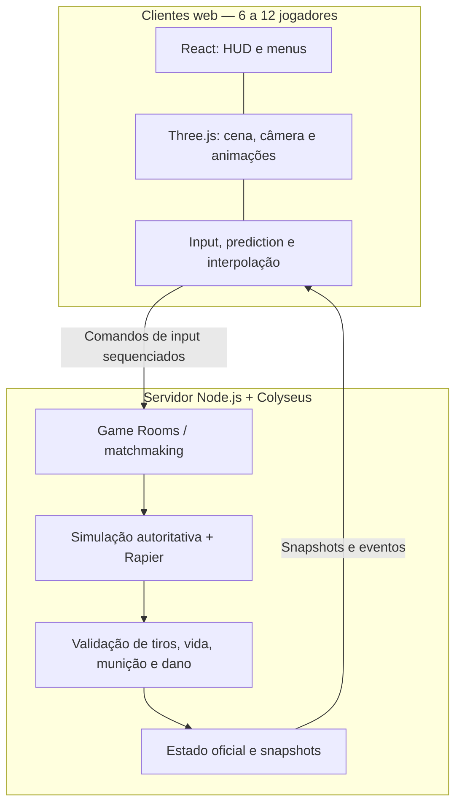
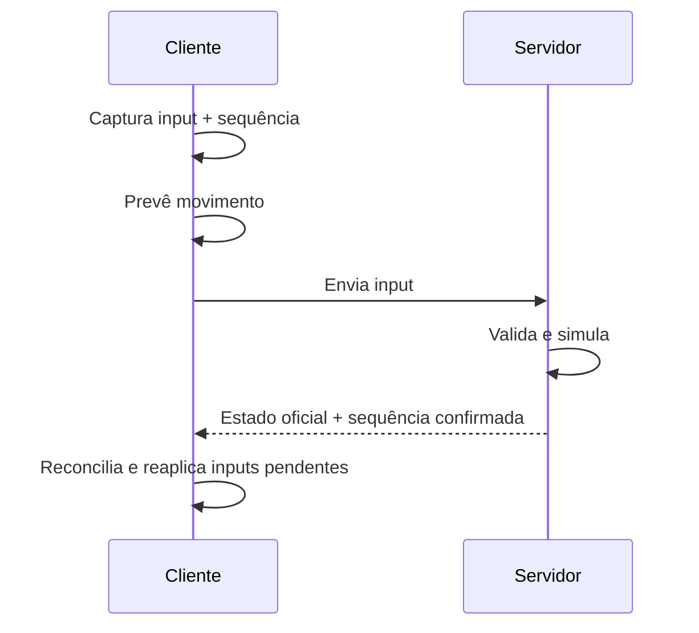

# FPS Web Multiplayer — Arquitetura e Plano de Desenvolvimento

> **Escopo:** FPS 3D para navegador, com visual cartunesco, movimentação inspirada em Call of Duty, partidas casuais de **6 a 12 jogadores**, armas e mãos animadas em primeira pessoa.
>
> **Status:** proposta inicial de arquitetura. Valores de networking e desempenho são pontos de partida para testes, não garantias.

## 1. Objetivos e princípios

- Movimentação responsiva: caminhada, sprint, tactical sprint (opcional), slide, pulo e agachamento.
- Combate em primeira pessoa com ADS, recoil, reload, inspect e troca de armas.
- Multiplayer com salas de 6–12 jogadores e sincronização fluida.
- Baixa complexidade inicial: **monorepo modular**, sem microsserviços nem Clean Architecture excessiva.
- **Servidor autoritativo** para movimento, vida, munição, disparos, dano, respawn e placar.
- Cliente responsável pela apresentação e pela previsão local, nunca pela decisão definitiva de acertos.

## 2. Stack recomendada

| Camada | Tecnologia | Responsabilidade |
| --- | --- | --- |
| Renderização 3D | **Three.js** | Câmera FPS, mapas, iluminação, personagens e armas |
| Interface | **React + TypeScript** | HUD, menus, lobby, configurações, placar |
| Física 3D | **Rapier** | Colisões, gravidade e controlador de personagem |
| Networking | **Colyseus** | Salas, matchmaking e sincronização de estado |
| Backend | **Node.js + TypeScript** | Simulação e regras autoritativas |
| Animação | **Three.js AnimationMixer** | Reprodução e transição de clips GLB/GLTF |
| Assets | **Blender + GLB/GLTF** | Rigging, ajustes de armas e exportação |
| Build | **Vite** | Desenvolvimento e build do cliente |
| Workspace | **pnpm workspaces** | Compartilhamento de protocolos e regras |

**Alternativas:** PlayCanvas e Babylon.js oferecem mais recursos integrados de engine. Para o projeto já iniciado em Three.js, manter Three.js evita uma migração desnecessária. Phaser é prioritariamente 2D e não é a opção recomendada para FPS 3D.

## 3. Arquitetura geral



### 3.1 Cliente

- Captura teclado, mouse e ações.
- Executa **client-side prediction** para seu próprio personagem.
- Interpola estados de jogadores remotos.
- Renderiza armas, mãos, recoil visual, sway, efeitos e áudio.
- Exibe estado de vida, munição e placar confirmado pelo servidor.

### 3.2 Servidor

- Hospeda salas e associa jogadores a sessões.
- Recebe comandos, limita frequência e valida sequências.
- Simula movimentos com passo fixo, colisões e regras.
- Valida cadência, munição, alcance, direção e acertos dos tiros.
- Calcula dano, mortes, respawn, pontuação e condições de vitória.
- Publica snapshots/patches e eventos relevantes.

## 4. Networking e tick rate

### 4.1 Configuração inicial sugerida

| Elemento | Valor inicial | Observações |
| --- | --- | --- |
| **Tick de simulação do servidor** | **30 Hz** | ~33,3 ms por tick; lógica e física em passo fixo |
| **Snapshots/patches para clientes** | **20 Hz** | ~50 ms entre atualizações; preferir diffs compactos |
| **Envio de inputs** | **30 Hz** | Pode agrupar comandos sem comprometer a sequência |
| **Renderização** | **60+ FPS** | Independente da rede, com `requestAnimationFrame` |
| **Buffer de interpolação remoto** | **~100 ms** | Ajustável conforme jitter e frequência dos snapshots |
| **Capacidade por sala** | **6–12 jogadores** | Medir CPU, RTT, banda e estabilidade |

**Perfis para testes:**

| Perfil | Tick de simulação | Snapshots | Aplicação |
| --- | ---: | ---: | --- |
| Econômico | 20 Hz | 10 Hz | Protótipos menos exigentes |
| **Padrão recomendado** | **30 Hz** | **20 Hz** | Casual para 6–12 jogadores |
| Alta precisão | 60 Hz | 30 Hz | Caso o combate exija e a infraestrutura suporte |

Ajustar após medir comportamento real; elevar o tick rate também aumenta custo de CPU e pode ampliar tráfego.

### 4.2 Previsão e correção de movimento

1. O cliente captura input (`move`, `look`, `jump`, `sprint`, `slide`) e adiciona um **número de sequência**.
2. Aplica o input imediatamente ao personagem local (**prediction**).
3. Envia o comando ao servidor via Colyseus.
4. O servidor valida e simula em tick fixo, retornando estado oficial e último input processado.
5. O cliente compara o resultado oficial com sua previsão, restaura o estado confirmado e reaplica os inputs ainda pendentes (**reconciliation**).
6. Personagens remotos são desenhados por interpolação entre estados recebidos.



**Cuidados:** usar timestep fixo e regras de movimento compartilháveis; Rapier em ambientes distintos não garante determinismo perfeito. Monitorar correções e evitar snap visual brusco. Não aceitar posições arbitrárias enviadas pelo cliente como verdade.

### 4.3 Combate e tiros

Para o MVP, usar **hitscan** (raycast) em vez de simular balas físicas para cada disparo:

1. Cliente aperta disparo e reproduz imediatamente muzzle flash, som e recoil visual.
2. Cliente envia comando de tiro com sequência e dados de mira necessários.
3. Servidor confere estado da arma, cadência, munição, origem/direção plausíveis e timestamp limitado.
4. Servidor faz raycast/hitbox no estado autoritativo, usando histórico recente de posições se houver lag compensation.
5. Servidor calcula dano, atualiza vida e notifica os clientes.
6. Cliente exibe hitmarker **confirmado** somente com evento validado, ou diferencia claramente feedback provisório do confirmado.

**Segurança:** aplicar limites para repetição de tiros, teleporte, velocidade, direção inválida e timestamps forjados. O servidor mantém autoridade sobre acertos e pontuação.

### 4.4 O que sincronizar

| Informação | Estratégia |
| --- | --- |
| Posição, orientação e velocidade relevantes | Snapshot/patch e interpolação |
| Inputs de movimento e ações | Mensagens com sequência e validação |
| Estados `idle`, `sprint`, `slide`, `reload`, `equip` | Estado/evento compacto; animação local |
| Vida, munição e placar | Estado autoritativo |
| Tiros, mortes e respawns | Eventos confirmados pelo servidor |
| Recoil visual, camera shake, weapon sway | Apenas cliente |
| Muzzle flash, partículas, áudio | Eventos essenciais + execução local |
| Posição individual dos ossos das mãos | **Não sincronizar** |

## 5. Animação de armas e mãos

Pesquisar por **FPS Viewmodel Animations** e **First Person Arms Animations**, com clips como:

- `idle`, `walk`, `sprint`, `tactical_sprint`;
- `fire`, `reload`, `inspect`, `equip`, `holster`;
- `jump`, `land`, `slide`, `ads` (ou ADS procedural).

Usar modelos rigados em **GLB/GLTF** e `THREE.AnimationMixer`. Transições podem ser controladas por uma máquina de estados de arma. Evitar combinar simultaneamente ações incompatíveis (ex.: `reload` e `inspect`). **Sway**, bob, ADS, câmera e parte do recoil podem ser procedurais com interpolação de transforms.

**Importante:** animações feitas para rigs diferentes não são automaticamente compatíveis. Alinhar esqueleto, mãos, carregadores, sockets e pivôs no Blender antes da importação.

### 5.1 Acervos para avaliar

- [PSX FPS Arms Free](https://heyheythere.itch.io/psx-fps-arms-free) — braços e animações, estilo retrô; verificar adequação estética e licença.
- [PSX FPS Arms — pacote completo](https://heyheythere.itch.io/psx-fps-arms) — opção com biblioteca maior.
- [Low Poly Animated Weapons](https://arms-dealer.itch.io/lowpolyweapons) — armas e animações estilizadas.
- [Low Poly FPS Starter Kit](https://rgsdev.itch.io/low-poly-fps-starter-kit) — opção de prototipagem.
- [WRAD Arms](https://wriks.itch.io/wrad-arms) — braços estilizados para rigging/ajustes.
- [Quaternius Animated Guns](https://tmhsdigital.github.io/Free-Game-Dev-Assets/entry/quaternius-animated-guns-pack/) — armas animadas low-poly.

Preços, disponibilidade, formatos e licenças devem ser conferidos nas páginas antes de uso comercial.

## 6. Estrutura de pastas recomendada

```text
fps-multiplayer/
├── apps/
│   ├── client/
│   │   ├── public/
│   │   │   └── assets/
│   │   │       ├── maps/
│   │   │       ├── weapons/
│   │   │       ├── characters/
│   │   │       └── audio/
│   │   └── src/
│   │       ├── game/
│   │       │   ├── core/            # game loop, configuração da cena
│   │       │   ├── player/          # input, câmera, prediction
│   │       │   ├── weapons/         # armas, ADS, recoil
│   │       │   ├── animation/       # clips, estados, transições
│   │       │   ├── physics/         # integrações Rapier
│   │       │   └── network/         # Colyseus, snapshots, reconciliation
│   │       ├── ui/                  # React: HUD, menus, lobby
│   │       └── main.ts
│   └── server/
│       └── src/
│           ├── rooms/              # GameRoom e estado da sala
│           ├── simulation/         # timestep e física autoritativa
│           ├── combat/             # hitboxes, raycast, dano
│           ├── matchmaking/        # entrada e distribuição em salas
│           └── index.ts
├── packages/
│   └── shared/
│       └── src/
│           ├── protocol/           # mensagens e schemas
│           ├── simulation/         # regras puras reutilizáveis
│           ├── config/             # armas, limites, constantes
│           └── types/
├── package.json
└── pnpm-workspace.yaml
```

**Regra de organização:** código visual fica no cliente; regras oficiais ficam no servidor; definições e funções seguras para compartilhar ficam em `shared`. Não espalhar cadência, dano ou parâmetros de armas em componentes React.

### 6.1 Configuração compartilhada de armas

```ts
// packages/shared/src/config/weapons.ts
export const WEAPONS = {
  rifle: {
    damage: 25,
    fireRate: 600,       // tiros por minuto
    magazineSize: 30,
    reloadTime: 2000,   // ms
    range: 150
  }
} as const;
```

O cliente usa esses dados para exibir informações e prever efeitos. O servidor aplica a configuração oficial ao validar cada ação.

## 7. Hospedagem e escalabilidade

**MVP:**

- Cliente como site estático em hospedagem web/CDN.
- **Uma instância Node.js sempre ativa** executando Colyseus, com suporte a WebSocket seguro (`wss://`).
- Múltiplas salas na mesma instância/processo, de acordo com capacidade medida.
- Estado temporário de partida em memória; sem banco de dados obrigatório para o MVP.
- Hospedar próximo à maior parte dos jogadores; para público brasileiro, testar uma região em São Paulo.

Adicionar Redis, banco de dados, persistência de perfil e distribuição em múltiplos servidores **somente quando uma necessidade concreta surgir**. Se o processo reiniciar, partidas armazenadas apenas em memória serão perdidas; definir o comportamento esperado de reconexão e queda de servidor.

## 8. Etapas de implementação

### Fase 1 — FPS local

- [ ] Criar mapa pequeno e cena Three.js.
- [ ] Implementar câmera FPS + pointer lock.
- [ ] Implementar personagem com Rapier.
- [ ] Adicionar caminhada, sprint, slide, pulo e agachamento.
- [ ] Adicionar uma arma, mira ADS e recoil visual.

**Critério de aceite:** um jogador percorre o mapa com colisões estáveis e movimentação satisfatória.

### Fase 2 — Primeira sala multiplayer

- [ ] Criar servidor Colyseus e `GameRoom`.
- [ ] Conectar dois navegadores à mesma sala.
- [ ] Criar e remover jogadores por conexão/desconexão.
- [ ] Sincronizar estados básicos de posição e orientação.

**Critério de aceite:** dois jogadores se enxergam no mesmo mapa e movimentos chegam aos outros clientes.

### Fase 3 — Netcode de movimentação

- [ ] Implementar comandos sequenciados com input buffer.
- [ ] Simulação autoritativa a 30 Hz.
- [ ] Implementar prediction e reconciliation.
- [ ] Implementar interpolação de jogadores remotos.
- [ ] Instrumentar RTT, jitter e tamanho de correções.

**Critério de aceite:** movimentação local responsiva e remota suave com latência simulada.

### Fase 4 — Combate

- [ ] Integrar animações de fire, reload, ADS e equip.
- [ ] Implementar disparos hitscan autoritativos.
- [ ] Validar cadência, munição, alcance e dano.
- [ ] Adicionar vida, mortes, respawn e placar.
- [ ] Implementar histórico de posições e lag compensation limitada, se necessário.

**Critério de aceite:** o servidor confirma acertos e mantém o estado consistente para todos.

### Fase 5 — Partidas completas

- [ ] Permitir 6–12 jogadores por sala.
- [ ] Criar lobby, preparação, início e fim de partida.
- [ ] Adicionar regras de vitória e temporizador.
- [ ] Tratar reconexão, abandono e fim antecipado.

**Critério de aceite:** uma partida completa acontece sem intervenção manual.

### Fase 6 — Testes e otimização

- [ ] Testar latência artificial de 50, 100 e 200 ms.
- [ ] Simular jitter, perda de conexão e reconexão.
- [ ] Testar 12 jogadores simultâneos, usando clientes reais e bots de carga.
- [ ] Medir CPU, memória e banda por jogador.
- [ ] Medir duração de ticks, render FPS, RTT e correções de prediction.
- [ ] Testar ações inválidas ou excessivas enviadas por clientes modificados.

**Critério de aceite:** partidas estáveis dentro dos limites de desempenho definidos pela equipe.

## 9. Métricas para acompanhar

| Métrica | Referência inicial |
| --- | --- |
| Tick rate efetivo | Sustentar 30 Hz sem backlog constante |
| FPS cliente | Almejar 60 FPS no hardware-alvo |
| RTT e jitter | Monitorar distribuição, não só média |
| Prediction/reconciliation | Correções raras e visualmente discretas |
| Banda por jogador | Medir upload/download em partidas reais |
| CPU/memória | Medir por sala e por instância |
| Consistência de combate | Acertos válidos iguais entre cliente e servidor |

## 10. Decisões arquiteturais iniciais

1. **Three.js em vez de Phaser** para FPS 3D.
2. **Colyseus + Node.js** para multiplayer por salas.
3. **Servidor autoritativo** desde a primeira integração online.
4. **30 Hz / 20 Hz** como ponto de partida para simulação/snapshots.
5. **Hitscan** no MVP para simplificar e estabilizar o combate.
6. **GLB + AnimationMixer** para animar viewmodels de mãos e armas.
7. **Monorepo `client` / `server` / `shared`** em vez de arquitetura distribuída precoce.
8. **Uma instância ativa** inicialmente, escalar com base em medições.

## 11. Referências

- [Three.js](https://threejs.org/)
- [Three.js — AnimationMixer](https://threejs.org/docs/#api/en/animation/AnimationMixer)
- [Rapier — JavaScript](https://rapier.rs/docs/user_guides/javascript/getting_started)
- [Colyseus — Documentação](https://docs.colyseus.io/)
- [Colyseus — Netcode](https://docs.colyseus.io/netcode)
- [Colyseus — Exemplos](https://github.com/colyseus/colyseus/tree/master/demos)
- [Blender](https://www.blender.org/)

---

**Resumo:** construir primeiro um FPS local divertido, adicionar networking autoritativo ainda no início e expandir para partidas de 12 pessoas antes de investir em infraestrutura complexa ou grandes quantidades de assets.
